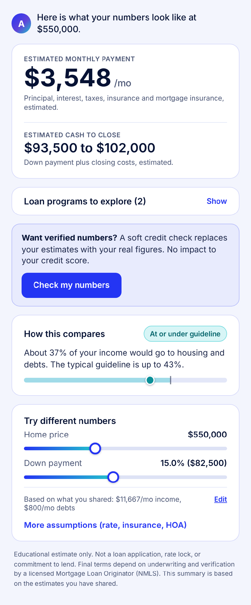
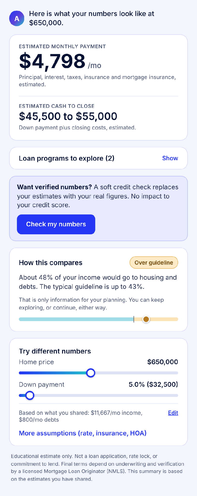
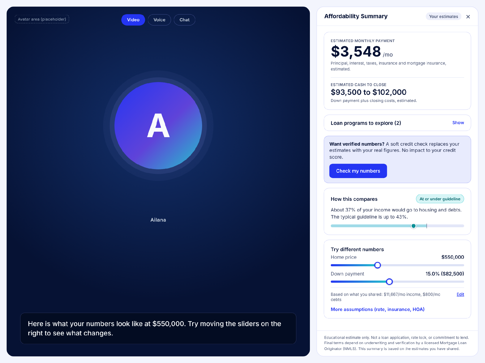

# Ailana Affordability Panel — Functional Specification v2 (Simplified)

**Nov 12, 2026** · David Patten

---

## 1. Purpose, scope, and what changes

This spec replaces the current Affordability Summary (the sandbox at `dev.convergentai.tech/sandbox/affordability`) with a simplified panel that answers one question: **is this monthly payment realistic for me?** Everything else moves behind a tap or is removed. The goal is engagement: first-time buyers who see too much stop interacting.

**In scope:** the Purchase layout on mobile, desktop split screen, and the narrow-window pop-up; stated-data and verified-data modes; the loan program row; on-screen copy; compliance flags; Ailana's prompting changes; and a test plan.

**Not yet specified:** Refinance and HELOC layouts. The mockups cover Purchase only. See section 13.

| Area | Current sandbox | This spec |
| :--- | :--- | :--- |
| Headline figures | Home price, monthly payment, cash to close | Monthly payment and cash to close only; price shown as context |
| Ratios | DTI table with "typical ranges" plus per-program DTI and LTV rows | One plain-English comparison line and one status chip |
| Applicant profile | Six-row table with typical ranges | One line: "Based on what you shared" with an Edit link |
| Sliders | Seven, all visible | Two visible (price, down payment); rate, insurance, HOA behind "More assumptions" |
| Programs | Cards with DTI and LTV rows | One collapsed row; two short factual lines when opened |
| Soft-check offer | Thin line mid-page | Card directly under the headline figures (stated mode) |
| Status wording | "Within / Outside of guidelines" | "At or under guideline" / "Over guideline" (needs compliance sign-off) |

---

## 2. Problem and design principles

The sandbox asks a first-time buyer to absorb about nine separate ideas at once: price, payment, cash to close, a warning line, six profile rows each with a range, DTI, LTV, program cards, and seven sliders. Terms like DTI and LTV are unfamiliar, and "Outside of guidelines" reads like a rejection. Users who are unsure what to look at tend to leave.

**Principles that govern every decision below:**

1. **One question per screen.** The first screen answers "is this payment realistic?" with two numbers and one sentence.
2. **Plain words.** No DTI, LTV, PITIA, or "compensating factors" on the main screen.
3. **Detail on request.** Anything beyond the answer sits behind a tap or is answered by Ailana when asked.
4. **Ailana explains, the panel confirms.** The avatar narrates; the panel is not a dashboard to decode alone.
5. **Two primary controls.** Price and down payment. Everything else is secondary.
6. **Neutral, compliant language.** Two status states only, no rejection framing, submission always available.
7. **One design across surfaces.** The same panel on mobile, desktop, and pop-up; only the container changes.

---

## 3. Screen specification (mobile, Purchase)

Components appear in this order, top to bottom. Mobile width is 390px; the panel scrolls vertically. Reference: the interactive canvas and PNGs listed in the appendix.

| # | Component | Content | Shown when | Behavior |
| :--- | :--- | :--- | :--- | :--- |
| 1 | Ailana line | One sentence from Ailana, text only | Mobile and pop-up | On desktop this moves to the avatar caption (section 4) |
| 2 | Headline card | Estimated monthly payment (large) and Estimated cash to close (a range), each with a one-line explainer | Always | Updates live as sliders move |
| 3 | Loan programs row | "Loan programs to explore (N)" with Show / Hide | Always | Collapsed by default; see section 7 |
| 4 | Soft-check offer | "Want verified numbers?" card with a "Check my numbers" button | Stated mode only | Calls the parent app's soft-pull flow; hidden in verified mode |
| 5 | Comparison card | Title "How this compares", a status chip, one plain-English sentence, and a bar with a guideline tick and a marker | Always | Chip and marker change with the scenario; see section 6 |
| 6 | Controls card | Price slider, down payment slider, "Based on what you shared" line with Edit, "More assumptions" toggle | Always | See section 8 |
| 7 | Disclaimer | Educational-estimate disclaimer | Always | Fixed wording in section 9; never removed or collapsed |

**What the first screen must show without scrolling** on a 390 x 844 phone: components 1 to 4, at least. The headline card and the programs row sit above the soft-check offer in the reference mockup. The order of 3 and 4 is a test (section 12), not a settled decision.

**Visual style:** light theme using ConvergentAI brand colors:

- **Electric Blue `#2435F3`** — primary button, links, slider handles
- **Teal `#22C5CC`** — fills (a darker teal for text on white)
- **Deep Navy `#061234`** — headlines and key numbers
- **Periwinkle `#8C95F1`** — borders
- **Amber** — over-guideline state (brand palette has no warning color)
- Touch targets are at least **44px**

---

## 4. Desktop split screen and pop-up

The sandbox switches layout at 1024px: split screen at 1024px and wider, pop-up modal below. This spec keeps that rule and the same panel content in both.

| Behavior | Split screen (1024px and wider) | Pop-up (under 1024px) |
| :--- | :--- | :--- |
| Container | Right-hand column, 480px wide, full height, beside Ailana | Modal over the conversation, full width on phones |
| Header | "Affordability Summary", a tag ("Your estimates" or "Verified"), and a close button | Same |
| Ailana line (component 1) | Removed from the panel; spoken text appears as the caption on the avatar side | Kept at the top of the panel |
| Disclaimer | Pinned footer; stays visible while the panel body scrolls | At the end of the scroll |
| Scrolling | The panel body scrolls inside its column on short screens | Modal body scrolls |
| Programs row | Collapsed by default (opening it by default on desktop is a test) | Collapsed |

Panel width stays narrow on purpose. Extra desktop width must not become extra content; that would bring back the clutter this spec removes.

**Mockup status:** split screen is mocked (PNG). The pop-up is not mocked; it is assumed to match the mobile layout in a modal frame. The avatar area in the desktop mockup is a placeholder, not your real avatar layout or controls.

---

## 5. Data inputs and modes

The panel must start from what the applicant told Ailana, never from demo values. Applicants can use the panel on stated information alone, or run a soft credit check to replace stated figures with verified ones. After seeing the stated-mode panel, they can still request the soft check.

| Input | Stated mode (before soft pull) | Verified mode (after soft pull) |
| :--- | :--- | :--- |
| Monthly gross income | Applicant's stated income (Q35) | Verified income |
| Monthly debts | Applicant's own estimate; correctable by the applicant | Bureau-verified; locked |
| Target price (Purchase) | Stated target price (Q41) | Same, still adjustable |
| Down payment | Stated amount, if any; otherwise a default | Same |
| Property tax, insurance, HOA | Estimates, adjustable under More assumptions | Same |
| Header tag | "Your estimates" | "Verified" |
| Soft-check offer | Shown | Hidden |
| Footer addition | "This summary is based on the estimates you have shared." | Not shown |

### Component props

From the delivered Next.js build. The existing component already accepts these; names may change when it is revised to this spec.

| Prop | Purpose |
| :--- | :--- |
| `transactionType` | Which layout opens: `TT-PUR`, `TT-REF`, `TT-HEL` (from the existing Q9 `transaction_type`) |
| `cashOutIntent` | Splits `TT-REF` into rate-and-term versus cash-out |
| `dataMode` | `"stated"` or `"pulled"` |
| `income` | Monthly gross income, stated or verified |
| `monthlyDebts` | Monthly debts, stated or verified |
| `initialAssumptions` | Seeds starting values (for example price from Q41); anything not passed falls back to defaults |
| `onRequestSoftPull` | Callback when the applicant taps "Check my numbers"; the parent app owns the soft-pull flow |

### Rules

- Without real `income` and `monthlyDebts` the panel **must not render** for an applicant. The demo defaults ($8,500 and $620) exist only for standalone previews.
- Guideline values and program rules come from the engine response, not hardcoded in the client (consistent with the v8.6 threshold rule).
- Changes the applicant makes with the sliders **do not alter** the pre-qualification record.

---

## 6. Calculations and status logic

The figures below match the mockups and the delivered component. All are educational estimates. Where a rule is marked "representative," it is an industry-typical placeholder that your underwriting or rate engine must replace.

| Figure | Rule | Status |
| :--- | :--- | :--- |
| Loan amount | Price x (1 minus down payment %); for FHA, VA, USDA the upfront fee is added and financed | Defined |
| Principal and interest | Standard 30-year (or 15-year) amortization at the assumed rate; default 6.375% | Rate is a placeholder |
| Property tax | 0.84% of price per year, divided by 12 | Representative |
| Homeowners insurance | Default $130 per month | Representative |
| HOA dues | Default $0 | Applicant-adjustable |
| Mortgage insurance | Conventional: tiered by loan-to-value, zero at 80% or below (0.30%, 0.51%, 0.70%, 0.90% a year in the bands above 80%). FHA: 0.55% a year plus 1.75% upfront, financed. VA: funding fee financed, no monthly insurance. USDA: 0.35% a year plus 1% upfront, financed | Representative |
| Monthly payment (headline) | Principal and interest, plus taxes, insurance, HOA, and mortgage insurance | Defined; which program drives it is open (section 13) |
| Cash to close (headline) | Down payment plus an estimated 2% to 3.5% of price for closing costs, rounded to the nearest $500, shown as a range | Placeholder; the sandbox also includes prepaids and reserves |
| Comparison percentage | (Monthly payment + monthly debts) divided by gross monthly income | Defined |
| Guideline | One number per program supplied by the engine; the mockup uses 43% as an illustration | Placeholder |

### Status rule

If the comparison percentage is **at or under** the guideline, the chip reads **"At or under guideline"** (teal). If it is **over**, the chip reads **"Over guideline"** (amber) and one planning sentence appears. There is no third state, no hard-stop, and no "not eligible" anywhere.

### Bar

The track runs from 0% to 60%. A thin tick marks the guideline. The marker sits at the current percentage, teal when at or under, amber when over. Status is also carried by the chip text, never by color alone.

### Control ranges

- **Price:** $200,000 to $1,200,000 in $5,000 steps
- **Down payment:** 3% to 30% in 0.5% steps; the minimum follows the program (FHA 3.5%, VA and USDA 0%)
- **Under More assumptions:**
  - Rate: 4% to 9% in 0.125% steps
  - Insurance: $40 to $400
  - HOA: $0 to $600

### Where the math runs

The delivered component computes these figures in the browser. Item 9 in the master doc says payment estimates are produced by the system and displayed on the panel. Browser-side math is reasonable for slider feedback; whether the starting figures must come from a server is an open decision (section 13).

---

## 7. Loan program row

The program row replaces the sandbox's program cards. It tells the applicant which programs exist and how they differ in plain words, and nothing more. Per-program DTI and LTV rows are removed from the screen.

**Collapsed (default).** A single row: "Loan programs to explore (N)" with a Show button. N is the number of programs listed.

**Opened.** One short factual block per program, then "Final eligibility and terms are decided by the lender." Draft descriptions:

| Program | One line (draft) | Source |
| :--- | :--- | :--- |
| Conventional | From 3% down. Mortgage insurance ends once you reach 20% equity. | In the reference mockup |
| FHA | From 3.5% down. Mortgage insurance for the life of the loan. | In the reference mockup |
| VA | No down payment required. One-time funding fee; no monthly mortgage insurance. | New; needs compliance review |
| USDA | No down payment required in eligible rural areas. Annual fee plus an upfront guarantee fee. | New; needs compliance review |

### Which programs appear

The existing R1 to R4 rules (VA if service-eligible, conventional if the score meets the floor, FHA if below, conventional if unknown) are built to choose a default program. Using them to choose which programs the applicant sees, or in what order, risks reading as steering.

**Recommended approach:** list every program the applicant's stated facts do not exclude (for example VA only after a service-eligibility answer), in one fixed order that does not vary by applicant, with no ranking or highlighting. Whether R1 to R4 still drives the headline payment is an open decision (section 13). Compliance Item 34 is already counsel-pending; this belongs in that review.

**Not on this screen:** DTI, LTV, and "within / outside of guidelines" per program. If an applicant asks how a program compares on ratios, Ailana answers in conversation (section 11).

---

## 8. Interaction behavior and states

| Element | Behavior |
| :--- | :--- |
| Price and down payment sliders | Update the payment, cash to close, comparison percentage, status chip, and bar continuously while dragging. Values display next to each label (down payment shows percent and dollars). |
| More assumptions | Toggle that reveals rate, insurance, and HOA sliders. Label changes to "Hide more assumptions" when open. Closed by default. |
| Programs row | Toggle between "Show" and "Hide". Closed by default. |
| "Based on what you shared" line | Shows stated income and monthly debts. Edit (stated mode): lets the applicant correct income or debts by tapping or by telling Ailana. In verified mode these values are locked and Edit is removed. |
| "Check my numbers" | Stated mode only. Calls `onRequestSoftPull`; the parent app runs consent and the soft pull. When verified data arrives, the panel re-renders in verified mode (tag changes, offer card disappears, debts lock). |
| Over guideline | Chip, marker, and bar turn amber and one planning sentence appears. Nothing is disabled or blocked; every control and the soft-check offer stay available. |
| Reset | The sandbox has a Reset link; the mockup omits it. Recommended: a small "Reset to starting estimate" link inside More assumptions. Not mocked. |
| Scroll | Mobile and pop-up scroll the page body; split screen scrolls inside the column with the disclaimer pinned. |

### Accessibility

- Real buttons and labeled inputs, not clickable divs
- Touch targets at least **44px**
- Text contrast at least **4.5:1** on its background
- Status is shown by words and position as well as color
- Every slider has an accessible name and a visible value

### Edge cases to handle

- A price that makes the loan amount zero or negative
- Down payment below the program minimum (the slider minimum follows the program)
- Missing income or debts (do not render; section 5)
- Very high payment values that push the marker past the end of the bar (clamp the marker at the right edge)

---

## 9. Exact on-screen copy

All wording below is **draft pending compliance review**. Bracketed items are filled from live values.

| Location | Copy |
| :--- | :--- |
| Ailana line (mobile, pop-up) | Here is what your numbers look like at [price]. |
| Desktop avatar caption | Here is what your numbers look like at [price]. Try moving the sliders on the right to see what changes. |
| Header tag | Your estimates (stated) / Verified (verified) |
| Payment label | Estimated monthly payment |
| Payment explainer | Principal, interest, taxes, insurance and mortgage insurance, estimated. |
| Cash label | Estimated cash to close |
| Cash explainer | Down payment plus closing costs, estimated. |
| Programs row | Loan programs to explore ([N]) / Show / Hide |
| Programs footer | Final eligibility and terms are decided by the lender. |
| Soft-check card | Want verified numbers? A soft credit check replaces your estimates with your real figures. No impact to your credit score. / Button: **Check my numbers** |
| Comparison title | How this compares |
| Status chip | At or under guideline / Over guideline |
| Comparison sentence | About [percent] of your income would go to housing and debts. The typical guideline is up to [guideline]. |
| Over-guideline line | That is only information for your planning. You can keep exploring, or continue, either way. |
| Controls title | Try different numbers |
| Slider labels | Home price / Down payment |
| Applicant data line | Based on what you shared: [income] per month income, [debts] per month debts / Edit |
| More assumptions | More assumptions (rate, insurance, HOA) / Hide more assumptions |
| Disclaimer (all modes) | Educational estimate only. Not a loan application, rate lock, or commitment to lend. Final terms depend on underwriting and verification by a licensed Mortgage Loan Originator (NMLS). |
| Disclaimer addition (stated mode) | This summary is based on the estimates you have shared. |

**Removed from the screen:** "Typical Range" labels, the six-row financial profile, "DTI" and "LTV" labels, "Outside of guidelines," and the line "Compensating factors such as strong credit, cash reserves, or a lower LTV may help qualification." That last line is the kind of statement Ailana should make only in conversation when asked.

---

## 10. Compliance requirements and flags

> I am not a compliance attorney. Everything here is drafted against the rules in the v8.7 master prompting document and needs counsel's review before it ships. Item numbers refer to that document.

| Item | Requirement | How this spec meets it | Status |
| :--- | :--- | :--- | :--- |
| 9 | Figures appear on screen; Ailana does not compute or estimate figures herself | All figures are panel output; Ailana points to the screen (section 11) | Open: whether starting figures must come from a server |
| 9-VOICE | Voice-only fallback for figures | Unchanged | No change |
| 10 | Neutral two-state status wording | "At or under guideline" / "Over guideline" with the guideline number shown; no third state | Wording change; sign-off required |
| 11 | Ailana never recommends, suggests, or instructs a value | Applies to every slider, including More assumptions | No change |
| 12 | Submission available regardless of ratios | Over-guideline line says the applicant can continue either way | Wording needs review |
| 34 | Program selection under review by counsel | Section 7 changes what the program row shows | Add to the pending review |
| Disclaimers | Non-binding estimate, NMLS reference | Fixed copy, pinned on desktop | No change |

### Flags for counsel

1. The over-guideline planning sentence and its amber styling.
2. The VA and USDA one-line descriptions (new text).
3. Whether choosing which programs appear, and in what order, is steering, and what neutral rule applies.
4. The guideline figures. The mockup's 43% and the component's per-program values are representative, not taken from DU, LPA, or GUS.
5. The expanded slider set under More assumptions (rate, insurance, HOA), which widens Item 11's reach.
6. Bringing HELOC into the same panel (section 13).

**Removed because it conflicted:** the three-zone "not eligible" gauge from the earlier build. It contradicted Items 10 and 12 and is not part of this design.

---

## 11. Ailana prompting revisions

Each entry is complete replacement or new text, not a diff, because I am working from the v8.8 revision package and my notes on v8.7, not the live v8.7 text. **Dev:** match each entry to the current formulation by its Q-number and replace it; check wording against the live document before applying.

This section builds on the v8.8 package. Where they differ, this section supersedes v8.8 on two points: the widened slider list in Q47 and the figure read-back in the Q48 variants. If v8.8 has not been applied, apply its Item 10 wording change first.

### Standing rules for all entries

- Ailana points to what is on the screen. She does not state figures unless the applicant asks; if asked, she reads back exactly what the panel shows (Item 9).
- Ailana never recommends a price, down payment, rate, or program (Items 11, 55).
- Unprompted, she says at most two sentences per panel update. Detail comes when asked.
- Status words are exactly **"at or under guideline"** and **"over guideline."** Never "approved," "denied," "qualify," "not eligible," or "outside."

---

### PR-1. Opening the panel
*Replaces Q46 / Q46-S opener*

**Stated mode:**
> "I've put a first look on your screen. At the top you'll see your estimated monthly payment and what you'd likely need at closing. Everything is an estimate based on what you've told me, and you can move the price or the down payment to see what changes."

**Verified mode:**
> "I've updated your screen using your verified information. At the top you'll see your estimated monthly payment and what you'd likely need at closing. You can still move the price or the down payment to see what changes."

---

### PR-2. Offering the soft credit check
*Replaces the stated-mode upgrade narration*

> "If you'd like to replace these estimates with your verified numbers, there's a soft credit check that doesn't affect your credit score. It's entirely your choice, and you can keep exploring either way."

Use once after PR-1, and again only if the applicant asks about verifying. Do not repeat it.

---

### PR-3. What can I change
*Replaces Q47*

> "You can change the home price or the down payment right on your screen. If you'd like to adjust the interest rate, insurance, or HOA dues, open 'More assumptions.'"

---

### PR-4. Narrating a change
*Replaces the Q48 band variants*

**Moves to at or under guideline:**
> "With that change, the comparison on your screen now reads 'at or under guideline,' and your estimated payment came down as well. These are yours to set, so keep exploring as long as you like."

**Moves to over guideline:**
> "With that change, the comparison on your screen now reads 'over guideline.' That's simply information for your planning. You're welcome to keep exploring, and you can submit for the formal review at any point either way."

**Payment or cash to close changed, status unchanged:**
> "Your estimated payment and cash to close on the screen both moved with that change. Cash to close is a range because closing costs vary."

**Removed:** the Q48 variants that cited the specific percentage and the mortgage-amount line variant from v8.8. Those figures are on screen; Ailana reads them back only if asked.

---

### PR-5. Proactive check-in when over guideline
*Replaces Q50*

> "I noticed the comparison on your screen reads 'over guideline' for this scenario. That's only information, and you're welcome to keep exploring. If you'd like to talk it through with a loan officer, I can connect you anytime."

---

### PR-6. Proactive submission invitation
*Q49*

Keep the existing text. Replace "sitting comfortably within the typical guideline ranges" with **"at or under guideline."**

---

### PR-7. The program row
*New*

**Announcing it, when the applicant asks what else is possible:**
> "There's a short list of loan programs on your screen. Open it if you'd like a quick look at how they differ. Final eligibility and terms are decided by the lender."

**"Which program should I pick?" (steering-safe):**
> "I can't tell you which is best for you. That's a conversation for underwriting once the full picture is known. What I can do is explain how each one works, like the down payment minimum and how mortgage insurance is handled. What matters most to you: the lowest monthly payment, the least cash up front, or avoiding monthly mortgage insurance?"

---

### PR-8. "What is this mortgage insurance amount?"
*Narrows Q53*

> "Your estimated payment includes mortgage insurance when it applies to the loan type. On a conventional loan it usually ends once you reach about 20% equity. FHA mortgage insurance typically stays for the life of the loan. VA loans have a one-time funding fee instead of monthly insurance, and USDA loans have an annual fee. I can walk through whichever one you're looking at."

The screen no longer shows a payment breakdown by default, so PR-8 does not point to a line on screen. If the team adds a breakdown view (section 13), add "you can see the breakdown by tapping [element]."

---

### PR-9. "What does this comparison mean?" or "What is DTI?"
*New, on request only*

> "It compares what you'd pay each month, housing plus your other debts, to your monthly income. Lenders look at that share, and a typical guideline is up to about [guideline] percent. It's a planning reference, not a decision, and the formal review looks at your whole file."

**If asked about "compensating factors":**
> "Lenders can sometimes consider other strengths in an application, like savings or credit history. Whether that applies to you is something underwriting decides."

---

### PR-10. Correcting income or debts
*Extends Q58, stated mode only*

> "You can tell me, or tap Edit on your screen, if your income or monthly debts have changed. Once you've run the soft credit check, those figures come from your verified information instead."

---

### PR-11. Surface rules
*New*

- **Desktop split screen:** the spoken opener is the caption on the avatar side; do not also expect the panel to repeat it.
- **Mobile and pop-up:** the same sentence appears as text at the top of the panel; speak the PR-1 version and do not read the panel text aloud.
- **Voice-only sessions:** unchanged (Item 9-VOICE).

**Unchanged:** Q54 ("Does this mean I'm approved?"), Q55 (no target value), Item 12, and all disclaimers.

---

## 12. Analytics and testing plan

The design rests on one assumption I cannot verify from here: that fewer elements raise engagement for first-time buyers. These steps test it.

**Before launch: five-second test.** Show five first-time buyers the screen for five seconds each, then ask what it is telling them and what they would tap. Repeat once with the over-guideline state.

### Events to capture

| Event | Why it matters |
| :--- | :--- |
| Panel shown (mode, surface, transaction type) | Denominator for everything else |
| First interaction and time to it | Direct measure of whether the screen invites engagement |
| Price slider moved; down payment slider moved | Whether the two primary controls get used |
| More assumptions opened | Whether secondary controls are wanted |
| Programs row opened | Decides collapsed versus visible (below) |
| "Check my numbers" tapped; soft pull completed | Conversion of the upgrade path |
| Edit tapped | Whether stated data is wrong often |
| Over-guideline shown; exit versus continue afterward | Whether the status wording discourages |
| Panel closed without interaction | Direct disengagement signal |

Break every metric out by **first-time buyer versus other applicants**, and by **mobile versus desktop**.

### Tests to run

1. **Programs row collapsed versus always visible.** If under roughly one in five applicants open the collapsed row, switch to the visible list or a hybrid.
2. **Order of the soft-check offer and the programs row.** Measure soft-check taps and time to first interaction.
3. **Desktop: programs row open by default versus collapsed.**

Sample sizes and success thresholds are for the team to set once traffic is known; the one-in-five figure is a starting guess, not a benchmark.

---

## 13. Open items and decisions needed

| # | Decision or gap | My recommendation |
| :--- | :--- | :--- |
| 1 | Which program drives the headline payment, and whether the screen says so. The mockup uses conventional math without saying. | Show the assumed program in the payment explainer, for example "Based on a conventional loan," and settle how R1 to R4 chooses it with counsel |
| 2 | Payment breakdown. The simplified panel shows no breakdown of principal, interest, taxes, insurance, and mortgage insurance. | Add a collapsed "What's in this payment" link under the payment; without it Ailana cannot point to a line on screen |
| 3 | Refinance and HELOC layouts are not designed. HELOC was brought into this panel in the v8.8 package without compliance review. | Design Purchase first; specify Refi and HELOC as a second pass using the same structure |
| 4 | Pop-up layout is not mocked. | Mock it before build; assume the mobile layout in a modal |
| 5 | Cash-to-close formula. The mockup uses down payment plus 2% to 3.5% of price; the sandbox also includes prepaids and reserves. | Use the engine's figure |
| 6 | Guideline source. The 43% and per-program values are placeholders. | Supply them from the underwriting or rate engine |
| 7 | Calculation location (Item 9). Browser-side math for slider feedback; open whether starting figures must come from a server. | Confirm with whoever owns Item 9 |
| 8 | Verified-mode details not mocked: whether to show the credit score, how the "Verified" tag looks, and what replaces the soft-check card. | Mock verified mode as a second state |
| 9 | Applied versions. I do not know whether the v8.8 package has been applied. | Confirm; section 11 assumes v8.8 is not yet live |
| 10 | Existing code. The delivered Next.js component implements the earlier, denser design. | Revise it to this spec; the calculation and prop contract carry over |
| 11 | Reset link and More assumptions defaults (section 8). | Add the small link; keep More assumptions closed |
| 12 | Real avatar layout and controls for the desktop mockup. | Provide a screenshot of the live split screen so the mockup can match |
| 13 | Compliance sign-offs listed in section 10. | Schedule one review covering all six flags |

---

## 14. Appendix: mockups, removed elements, change log

### Mockups

- **Interactive canvas** with two live phone-sized versions (Option A: programs collapsed; Option B: programs as a short list). Sliders work. Option A has the program row under the payment numbers. Link: `https://claude.ai/artifact/6i6D3n5r1GJntmRpvcfr2S`. This canvas uses a neutral navy style, not the final brand colors.
- **Branded PNGs, light theme:** at or under guideline (mobile), over guideline (mobile), and desktop split screen. They are reproduced below.
- A dark-theme PNG was also made and set aside because it made the details harder to judge.

---

#### Mobile — At or under guideline

*Branded PNG, light theme. Shows the mobile (390px) panel in the "at or under guideline" state with teal status chip, estimated monthly payment, cash to close, programs row, soft-check offer, comparison bar, and sliders.*

---

#### Mobile — Over guideline

*Branded PNG, light theme. Shows the mobile (390px) panel in the "over guideline" state with amber status chip, the planning sentence, and all controls still active.*

---

#### Desktop — Split screen

*Branded PNG, light theme. Shows the 1024px+ layout with Ailana on the left and the 480px affordability panel on the right. The avatar area is a placeholder, not the live layout.*

---

### Removed from the sandbox

| Element | Disposition |
| :--- | :--- |
| Credit Score row ("N/A" in stated mode) | Removed; revisit for verified mode (section 13, item 8) |
| Typical Range labels | Removed |
| Six-row Financial Profile table | Replaced by one summary line with Edit |
| DTI and LTV rows on program cards | Removed; Ailana explains on request |
| Warning line plus compensating-factors sentence | Replaced by the status chip, one sentence, and the planning line |
| Interest rate, HOA, insurance, term sliders | Behind More assumptions (term toggle not mocked; decide whether to keep) |
| Reset link | See section 8 |

### Change log

| Version | Change |
| :--- | :--- |
| Sandbox | Nine-part panel, "Within / Outside of guidelines" wording |
| v8.8 package | Two-state wording, mortgage amount, expanded sliders, HELOC in panel |
| This spec (v2) | Simplified single-answer panel; two default sliders; program row; desktop split screen; prompting revised (supersedes v8.8 on Q47 and Q48) |

**Impact on delivered code.** The Next.js component delivered earlier implements the denser design with three gauges, four program tabs, and seven visible sliders. It must be revised to this spec. The calculation logic, program configuration, and prop contract (section 5) carry over.
