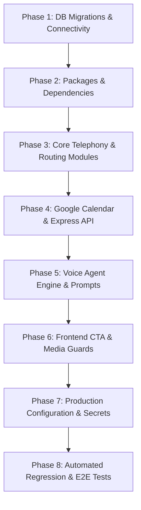

# Implementation Blueprint & Step-by-Step Execution Plan
## Porting Intelligent Routing, SIP Trunking & Loan Officer Telephony from Lab to Dev
*Target Environment: Main Dev Workspace (`/`)*
*Source Reference: `convergentai-lab` (Production v7.5.19/v7.5.20 Baseline)*
*Master Specification: [`SIP_ROUTING_COMPARISON_AND_GAP_ANALYSIS.md`](file:///c:/Users/Sherry/Documents/Convergent_AI/SIP_ROUTING_COMPARISON_AND_GAP_ANALYSIS.md)*

---

### Executive Overview & Workflow Principles

This plan provides an exhaustive, sequential, phase-by-phase execution roadmap to port 100% of the SIP trunking, dynamic geographic queue routing, FreeSWITCH ESL availability gates, Ringotel/SIP multi-channel alerting, human answer detection, and Google Calendar voice fallback from `convergentai-lab` into the Dev workspace.

#### Core Execution Principles:
1. **Strict Phase & Step Ordering**: Each phase builds on the previous phase. Every step has explicit entry criteria, actions, and verification tests.
2. **Preserve Dev Features**: Dev's existing LemonSlice video avatar engine, session snapshots (`restoreSnapshot`, `onRestoreSent`, `SYSTEM_RESTORE_STATE`), and prequalification stages are preserved. ProtoFace avatar code from Lab is excluded.
3. **Dual-Database Discipline**:
   - `DATABASE_URL`: Application PostgreSQL DB (stores `users`, `applications`, `appointments`, and notification audit).
   - `FSPBX_DB_*`: FusionPBX PostgreSQL DB at `192.168.10.10:5432` (stores `routing.zip_state`, `routing.state_queue`, `routing.loan_officers`, `routing.officer_states`).

---



---

## Phase 1: Database Schema Migrations & FSPBX DB Connectivity

**Objective**: Ensure the Application PostgreSQL database has the required schema for appointment persistence and notification auditing, and verify network reachability to the FusionPBX database.

### Step 1.1: Copy Prisma Migration Folders from Lab to Dev
- **Source**:
  - `convergentai-lab/prisma/migrations/20260830113000_add_scheduler_appointments/`
  - `convergentai-lab/prisma/migrations/20260830123000_add_booking_notification_audit/`
- **Destination**:
  - `prisma/migrations/20260830113000_add_scheduler_appointments/migration.sql`
  - `prisma/migrations/20260830123000_add_booking_notification_audit/migration.sql`
- **Action**: Copy the migration directories containing the SQL DDL statements for table `appointments` and its audit fields (`notification_email`, `notification_status`, `notification_message_id`, `notification_sent_at`).
- **Verification**: Verify files exist at target paths.

### Step 1.2: Apply Migrations to Application PostgreSQL DB
- **Action**: Run Prisma migration command in the workspace root:
  ```bash
  npx prisma migrate dev --name sync_scheduler_appointments
  ```
  *(Or execute raw SQL against `DATABASE_URL` if working against an existing database)*.
- **Verification**: Query PostgreSQL table:
  ```sql
  SELECT column_name, data_type FROM information_schema.columns WHERE table_name = 'appointments';
  ```
  Confirm existence of `confirmation_number`, `booking_key`, `google_event_id`, `start_time_utc`, `end_time_utc`, `notification_status`.

### Step 1.3: Verify FSPBX PostgreSQL Connectivity
- **Action**: Test connection from Dev backend to `192.168.10.10:5432` with credentials:
  - User: `fusionpbx`
  - DB: `fusionpbx`
  - Password: `<FSPBX_DB_PASSWORD from be.env_github>`
- **Verification**: Run query against FusionPBX DB:
  ```sql
  SELECT count(*) FROM routing.zip_state;
  SELECT count(*) FROM routing.state_queue;
  ```
  Confirm `routing.zip_state` and `routing.state_queue` return valid row counts.

### Step 1.4: Copy FusionPBX 60-Second Queue Hold SQL Script
- **Source**: `convergentai-lab/scripts/fspbx-update-queue-wait-60s.sql`
- **Destination**: [`scripts/fspbx-update-queue-wait-60s.sql`](file:///c:/Users/Sherry/Documents/Convergent_AI/scripts/fspbx-update-queue-wait-60s.sql)
- **Action**: Copies the migration script that updates `v_call_center_queues` in FusionPBX to set `queue_max_wait_time = '60'` and `queue_max_wait_time_with_no_agent = '60'` across all 51 state queues (`communitymtg_mlo_*`).
- **Verification**: Verify file exists at `scripts/fspbx-update-queue-wait-60s.sql`.

---

## Phase 2: Backend Dependencies & Package Installation

**Objective**: Install required PostgreSQL connection pool and Google Workspace client libraries in the backend.

### Step 2.1: Update `backend/package.json`
- **Target File**: [`backend/package.json`](file:///c:/Users/Sherry/Documents/Convergent_AI/backend/package.json)
- **Action**: Add missing dependencies:
  - `"pg": "^8.11.3"`
  - `"googleapis": "^171.4.0"`
  - `"@types/pg": "^8.11.6"` (in `devDependencies`)
- **Verification**: Verify entries are added to `dependencies` and `devDependencies`.

### Step 2.2: Execute Package Installation
- **Action**: Run npm install inside `backend/`:
  ```bash
  cd backend && npm install
  ```
- **Verification**: Confirm `node_modules/pg` and `node_modules/googleapis` exist without dependency resolution errors.

---

## Phase 3: Core Telephony, Routing & Security Libraries

**Objective**: Port all low-level routing, intent recognition, FreeSWITCH ESL socket, and SIP transfer utilities from Lab to Dev.

### Step 3.1: Copy Geographic ZIP Resolver
- **Source**: `convergentai-lab/backend/src/lib/zipResolver.ts`
- **Destination**: [`backend/src/lib/zipResolver.ts`](file:///c:/Users/Sherry/Documents/Convergent_AI/backend/src/lib/zipResolver.ts)
- **Exports**:
  - `resolveQueueForZip(zipCode: string): Promise<ResolvedQueue | null>`
  - `resolveAgentForZip(zipCode: string): Promise<ResolvedAgent | null>`
  - `getLicensedAgentsForZip(zipCode: string): Promise<AgentRow[]>`
- **Verification**: Verify module imports `pg` Pool correctly and queries `routing.zip_state` and `routing.state_queue`.

### Step 3.2: Copy Intent & Spoken Digit Normalizer
- **Source**: `convergentai-lab/backend/src/lib/mlo-transfer-intent.ts`
- **Destination**: [`backend/src/lib/mlo-transfer-intent.ts`](file:///c:/Users/Sherry/Documents/Convergent_AI/backend/src/lib/mlo-transfer-intent.ts)
- **Exports**:
  - `normalizeSpokenZip(text: string | null | undefined): string | null` (normalizes *"tree four oh two five"* ➔ `"34025"`, *"nine eye one zero three"* ➔ `"98103"`).
  - `isLoanOfficerTransferIntent(text: string | null | undefined): boolean` (action verb + role term).
  - `isContextualLoanOfficerTransferConfirmation(text: string, awaitingLoanOfficerChoice: boolean): boolean`.
- **Verification**: Run unit test: `node --import tsx backend/src/__tests__/mlo-transfer-intent.test.ts`.

### Step 3.3: Copy Contact Input Voice Accumulator
- **Source**: `convergentai-lab/backend/src/lib/contact-input.ts`
- **Destination**: [`backend/src/lib/contact-input.ts`](file:///c:/Users/Sherry/Documents/Convergent_AI/backend/src/lib/contact-input.ts)
- **Exports**:
  - `extractSpokenPhoneDigits(text: string, isContactContext: boolean): string | null`
  - `appendPhoneFragment(currentBuffer: string, newFragment: string)`
- **Verification**: Run unit test: `node --import tsx backend/src/__tests__/contact-input.test.ts`.

### Step 3.4: Copy Security & Redaction Utilities
- **Source**: `convergentai-lab/backend/src/utils/security.ts`
- **Destination**: [`backend/src/utils/security.ts`](file:///c:/Users/Sherry/Documents/Convergent_AI/backend/src/utils/security.ts)
- **Exports**:
  - `safeErrorMessage(error: unknown): string` (masks tokens, passwords, and JWTs in logs).
  - `safeTelemetryDetails(details: unknown): Record<string, unknown>`
  - `allowRequest(key: string, limit: number): boolean` (in-memory rate limiter).
  - `requestKey(req: Request, prefix: string): string`
- **Verification**: Run unit test: `node --import tsx backend/src/__tests__/security-hardening.test.ts`.


### Step 3.5: Copy FreeSWITCH SIP MESSAGE Dispatcher
- **Source**: `convergentai-lab/backend/src/utils/fsMessage.ts`
- **Destination**: [`backend/src/utils/fsMessage.ts`](file:///c:/Users/Sherry/Documents/Convergent_AI/backend/src/utils/fsMessage.ts)
- **Exports**:
  - `sendSipMessage(extension: string, domain: string, body: string): Promise<boolean>`
- **Action**: Connects over FreeSWITCH ESL port 8021 and sends `SMS::SEND_MESSAGE` event to `mod_sms` to display alert text on physical deskphones and softphones.
- **Verification**: Check function compiles cleanly with strict TypeScript options.

### Step 3.6: Copy FreeSWITCH ESL Client & Availability Checker
- **Source**: `convergentai-lab/backend/src/services/freeswitch-esl.ts`
- **Destination**: [`backend/src/services/freeswitch-esl.ts`](file:///c:/Users/Sherry/Documents/Convergent_AI/backend/src/services/freeswitch-esl.ts)
- **Exports**:
  - `isEslConfigured(): boolean`
  - `getQueueMembers(queueExtension: string): Promise<QueueMember[]>`
  - `getQueueAvailability(queueExtension: string, forceRefresh = false): Promise<QueueAvailability>`
  - `getStableQueueAvailability(queueExtension: string, settleMs = 350): Promise<QueueAvailability>`
  - `waitForQueueAgentAnswer(queueExtension: string, timeoutSeconds = 20, pollIntervalMs = 350): Promise<{ extension: string; state: string } | null>`
- **Action**: Reconciles runtime tiers (`queue reload`, `tier del`), queries `sofia_contact`, checks agent status (`Available`) and state (`Waiting`), and polls for human answer (`in a queue call`).
- **Verification**: Test compilation and ensure environment variable fallbacks match production specs.

### Step 3.7: Replace `backend/src/utils/sipTransfer.ts`
- **Target File**: [`backend/src/utils/sipTransfer.ts`](file:///c:/Users/Sherry/Documents/Convergent_AI/backend/src/utils/sipTransfer.ts)
- **Action**: Replace Dev's 62-line static file with Lab's 349-line implementation:
  - `normalizedSipFromNumber()`: strips non-digits and sanitizes scientific float representation (`1.42e+10` ➔ `14238931776`).
  - `resolveQueueForZip(zip)`: maps ZIP to state queue `7001`–`7050`.
  - `sendRingotelAlert(extension, body)`: calls `https://shell.ringotel.co/api` with session renewal.
  - `sendSipMessage(extension, domain, body)`: calls ESL `fsMessage`.
  - `effectiveRingingTimeout`: bounds timeout between 5s and 80s (default 60s).
  - `waitUntilAnswered: true`: passes flag to LiveKit SIP client.
  - `hangupMloParticipant(roomName, identity)`: disconnects SIP leg cleanly.
  - `deleteMloRoom(roomName)`: deletes temporary LiveKit room.
- **Verification**: Inspect exported types and functions; ensure zero TypeScript errors.

---

## Phase 4: Google Calendar Recovery, Scheduling & Notification Services

**Objective**: Port conversational voice scheduling, Google Calendar integration, Gmail notifications, and Express REST routes.

### Step 4.1: Copy Google Calendar Service
- **Source**: `convergentai-lab/backend/src/services/google-calendar.ts`
- **Destination**: [`backend/src/services/google-calendar.ts`](file:///c:/Users/Sherry/Documents/Convergent_AI/backend/src/services/google-calendar.ts)
- **Exports**:
  - `listAvailableSlots(input: { zipCode: string; customerTimeZone: string; requestedDate?: string; days?: number })`
  - `createCalendarAppointment(input: { token: string; customerName: string; customerEmail: string; customerTimeZone: string; zipCode: string; queueName?: string; ... })`
  - `verifyBookingToken(token: string): BookingTokenPayload` (validates HMAC-SHA256 signature).
  - `deleteCalendarEvent(calendarId: string, eventId: string): Promise<void>`
  - `isGoogleCalendarConfigured(): boolean`
- **Verification**: Verify Google Calendar API JWT auth structure using `GOOGLE_SERVICE_ACCOUNT_JSON` and `GOOGLE_IMPERSONATE_USER`.

### Step 4.2: Copy Conversational Scheduling Bridge
- **Source**: `convergentai-lab/backend/src/services/conversational-scheduling.ts`
- **Destination**: [`backend/src/services/conversational-scheduling.ts`](file:///c:/Users/Sherry/Documents/Convergent_AI/backend/src/services/conversational-scheduling.ts)
- **Exports**:
  - `resolveConversationalSchedulingRoute(zipCode: string): Promise<SchedulingRoute | null>`
  - `findConversationalSlots(zipCode: string, customerTimeZone: string, requestedDate?: string)`
  - `bookConversationalAppointment(input: ConversationalBookingInput)`
- **Verification**: Ensure seamless integration with `google-calendar.ts` and `booking-notification.ts`.

### Step 4.3: Copy Booking Notification Service
- **Source**: `convergentai-lab/backend/src/services/booking-notification.ts`
- **Destination**: [`backend/src/services/booking-notification.ts`](file:///c:/Users/Sherry/Documents/Convergent_AI/backend/src/services/booking-notification.ts)
- **Exports**:
  - `sendBookingNotification(input: BookingNotificationInput): Promise<BookingNotificationResult>` (staff alert).
  - `sendCustomerBookingConfirmation(input: BookingNotificationInput): Promise<BookingNotificationResult>` (customer calendar invite).
- **Action**: Uses Google Workspace Gmail API via impersonated account `GOOGLE_BOOKING_NOTIFICATION_FROM` (`info@convergentai.tech`). Updates notification audit fields in `appointments` table.
- **Verification**: Check RFC 2822 MIME message formatting and Gmail API call syntax.

### Step 4.4: Copy Express Route `loan-officer.ts`
- **Source**: `convergentai-lab/backend/src/routes/loan-officer.ts`
- **Destination**: [`backend/src/routes/loan-officer.ts`](file:///c:/Users/Sherry/Documents/Convergent_AI/backend/src/routes/loan-officer.ts)
- **Endpoints**:
  - `POST /api/session`: creates room session and issues token.
  - `POST /api/dial`: initiates SIP dial to queue with `RINGOTEL_DELAY_MS`.
  - `POST /api/hangup`: cleanly terminates SIP call.
  - `GET /api/call-events/:roomName`: SSE stream for call events.
  - `GET /api/zip-agents`: returns licensed agents and availability for a ZIP.
  - `GET /api/detect-zip`: parallel IP geolocation (`ipwho.is` and `ipapi.co`).
  - `POST /api/early-alert`: dispatches asynchronous pre-call Ringotel push and FreeSWITCH SIP text alerts to queue officers.
- **Verification**: Check route file compiles with strict Express types.

### Step 4.5: Copy Express Route `scheduling.ts`
- **Source**: `convergentai-lab/backend/src/routes/scheduling.ts`
- **Destination**: [`backend/src/routes/scheduling.ts`](file:///c:/Users/Sherry/Documents/Convergent_AI/backend/src/routes/scheduling.ts)
- **Endpoints**:
  - `GET /api/mlo-availability`: queries ESL queue availability for a ZIP code.
  - `GET /api/scheduling/slots`: returns bookable Google Calendar slots.
  - `POST /api/scheduling/book`: verifies HMAC booking token, creates Google Calendar event, stores `appointments` record, and dispatches confirmation emails.
- **Verification**: Check SQL insert queries and token verification.

### Step 4.6: Update `backend/src/index.ts`
- **Target File**: [`backend/src/index.ts`](file:///c:/Users/Sherry/Documents/Convergent_AI/backend/src/index.ts)
- **Action**:
  - Import `loanOfficerRoutes` and `schedulingRoutes`.
  - Mount routers:
    ```typescript
    app.use('/api', loanOfficerRoutes);
    app.use('/api', schedulingRoutes);
    ```
  - Mount service health check:
    ```typescript
    app.get('/api/health', (_req: Request, res: Response) => {
      res.json({
        status: 'ok',
        timestamp: new Date().toISOString(),
        services: {
          livekit: !!process.env.LIVEKIT_API_KEY,
          fspbx: !!process.env.FSPBX_DB_HOST,
          ringotel: Boolean(process.env.RINGOTEL_API_URL && process.env.RINGOTEL_AUTH_TOKEN && process.env.RINGOTEL_ORG_ID),
          freeswitchEsl: isEslConfigured(),
          googleCalendar: isGoogleCalendarConfigured(),
        },
      });
    });
    ```
  - Add security headers and rate limits (`allowRequest(requestKey(req, 'livekit-token'), 12)`).
- **Verification**: Start backend with `npm run dev` and test: `curl http://localhost:3001/api/health`.

---

## Phase 5: Voice Agent Engine & Escalation Prompts

**Objective**: Wire pre-flight checks, selective WebRTC audio isolation, FreeSWITCH ESL answer detection, and Google Calendar voice tools into `agent.ts` and `stage5-escalation.ts`.

### Step 5.1: Update `backend/src/prompts/stage5-escalation.ts`
- **Target File**: [`backend/src/prompts/stage5-escalation.ts`](file:///c:/Users/Sherry/Documents/Convergent_AI/backend/src/prompts/stage5-escalation.ts)
- **Action**: Add conversational scheduling prompt rules:
  - Instructs Ailana: *"Scheduling happens entirely in this voice conversation. Never direct the customer to an on-screen calendar or popup."*
  - Strict tool sequence: collect preferred date/time and time zone ➔ call `findMeetingTimes` ➔ offer at most 3 slots ➔ ask for explicit consent ➔ call `confirmMeeting` ➔ read confirmation number aloud.
  - Instructs: *"If the borrower chooses a live transfer or asks to talk now, tell them you are checking the licensed queue for their property ZIP. The backend voice-transfer handler will perform the transfer; never tell them to click a button."*
- **Verification**: Verify stage prompt string compiles and includes all conversational scheduling rules.

### Step 5.2: Wire Scheduling Tools & Dynamic Instructions in `backend/src/agent.ts`
- **Target File**: [`backend/src/agent.ts`](file:///c:/Users/Sherry/Documents/Convergent_AI/backend/src/agent.ts)
- **Action**:
  - Declare `voiceScheduling: VoiceSchedulingState` object tracking `active`, `completedAt`, `confirmationNumber`, `zipCode`, `queueName`, `queueNumber`, `slots`.
  - Define `schedulingTools`:
    - `findMeetingTimes`: takes `requestedDate`, `customerTimeZone`. Calls `findConversationalSlots`.
    - `confirmMeeting`: takes `slotOption`, `customerTimeZone`, `explicitConsent`. Reuses profile contact details (`contact_name`, `legal_name`, `borrower_name`, `contact_email`, `contact_mobile`). Calls `bookConversationalAppointment`. Reads confirmation number.
    - `cancelMeetingScheduling`: resets `voiceScheduling.active = false`.
  - Pass `tools: schedulingTools` to `createVadAgent()`.
  - Define `conversationalSchedulingInstructions()` and inject dynamically in `onUserTurnCompleted`:
    ```typescript
    if (this.isConversationalSchedulingActive()) {
      // Replaces instructions with conversationalSchedulingInstructions
      // Strips out lk.agent_dynamic_state to suppress mortgage prequal questions
    }
    ```
- **Verification**: Confirm tools compile with Zod parameter schemas.

### Step 5.3: Implement Pre-Flight Availability Check in `agent.ts`
- **Target File**: [`backend/src/agent.ts`](file:///c:/Users/Sherry/Documents/Convergent_AI/backend/src/agent.ts)
- **Action**: In `SYSTEM_TRANSFER_MLO` handler:
  - Resolve property ZIP: `const queue = await resolveQueueForZip(requestedZip);`
  - Query availability: `const availability = await getStableQueueAvailability(queue.queueExtension);`
  - If `!availability.available`: throw `NO_AGENT_AVAILABLE` before dialing any SIP leg.
- **Verification**: Verify error catch block triggers `startConversationalScheduling` with reason `no_agent_available`.

### Step 5.4: Implement Selective WebRTC Track Preservation in `agent.ts`
- **Target File**: [`backend/src/agent.ts`](file:///c:/Users/Sherry/Documents/Convergent_AI/backend/src/agent.ts)
- **Action**: Replace bulk de-subscription with selective customer preservation:
  ```typescript
  for (const p of ctx.room.remoteParticipants.values()) {
    if (p.identity.startsWith('guest_')) continue; // Preserve customer mic track!
    for (const pub of p.trackPublications.values()) {
      try { pub.setSubscribed(false); } catch (_) { }
    }
  }
  ```
- **Verification**: Verify customer microphone remains subscribed so `AgentSession` audio input stream is never disrupted.

### Step 5.5: Implement ESL Human Answer Polling Gate in `agent.ts`
- **Target File**: [`backend/src/agent.ts`](file:///c:/Users/Sherry/Documents/Convergent_AI/backend/src/agent.ts)
- **Action**:
  - Dial queue via `transferRoomToMloQueue({ roomName, zip })`.
  - Poll ESL agent state: `const answeredAgent = await waitForQueueAgentAnswer(queue.queueExtension);`
  - On answer: close avatar video session, emit `SYSTEM_MLO_AGENT_CONNECTED`, and keep Ailana hibernated.
  - On timeout: catch error, call `hangupMloParticipant`, emit `SYSTEM_MLO_UNSUPPORTED`, and call `startConversationalScheduling`.
- **Verification**: Check ESL polling loop handles timeout cleanly and teardown executes without unhandled rejections.

### Step 5.6: Implement Caller Disconnect Cleanup & Location Sync in `agent.ts`
- **Target File**: [`backend/src/agent.ts`](file:///c:/Users/Sherry/Documents/Convergent_AI/backend/src/agent.ts)
- **Action**:
  - In `RoomEvent.ParticipantDisconnected`:
    ```typescript
    const sipId = activeSipIdentity;
    activeSipIdentity = null;
    if (sipId) {
      await sip.hangupMloParticipant(ctx.room.name || '', sipId).catch(() => {});
    }
    await sip.deleteMloRoom(ctx.room.name || '');
    ```
  - In `RoomEvent.ChatMessage`:
    ```typescript
    if (messageText === 'SYSTEM_LOCATION_ZIP') {
      contextManager.getProfile().zip_code = zip;
      if (voiceMloTransfer.active) voiceMloTransfer.zip = zip;
    }
    ```
- **Verification**: Verify room cleanup and profile ZIP synchronization.

### Step 5.7: Implement Spoken Transfer Interceptor (`requestMloTransferHandler`)
- **Target File**: [`backend/src/agent.ts`](file:///c:/Users/Sherry/Documents/Convergent_AI/backend/src/agent.ts)
- **Action**:
  - Implement `requestMloTransferHandler`:
    - Checks `voiceScheduling.active`: if conversational scheduling owns the turn, bypasses transfer logic.
    - Suppresses casual post-booking acknowledgements when `voiceScheduling.completedAt > 0` using regex:
      `/^(?:oh\s+)?(?:yes|yeah|yep|sure|okay|ok|no|nope|thanks|thank\s+you|all\s+set|please)(?:[\s.,!]+(?:yes|yeah|yep|sure|okay|ok|no|nope|thanks|thank\s+you|all\s+set|please))*[\s.,!]*$/i`
    - Evaluates explicit transfer intents (`isLoanOfficerTransferIntent(text)`) and Stage 5 contextual affirmations (`isContextualLoanOfficerTransferConfirmation(text, awaitingChoice)`).
    - Detects customer cancellation intent:
      `/\b(?:never mind|nevermind|cancel|stop|do not|don't)\b[\s\S]{0,30}\b(?:transfer|connect|call|loan officer|representative)?\b/i`
      Resets `voiceMloTransfer.active = false` and speaks: *"No problem. We can continue here with Ailana."*
    - Normalizes spoken ZIPs (`normalizeSpokenZip(text)`).
    - If 5-digit property ZIP is missing: moves to `awaiting_zip`, throttles re-prompting to 8,000ms. Delivers spoken prompt on attempt 1, and Chat prompt (*"Please type all five digits in Chat, for example 90001"*) on attempt $\ge 2$.
    - Once 5-digit ZIP is obtained: dispatches `handleSystemMessages('SYSTEM_TRANSFER_MLO', undefined, { zip })`.
  - Wire to agent turn interceptor:
    ```typescript
    agent.globalTurnInterceptor = async (text: string) => {
      if (voiceScheduling.active) return false;
      return requestMloTransferHandler ? requestMloTransferHandler(text) : false;
    };
    ```
- **Verification**: Verify borrower's spoken transfer request triggers the queue dialer while questions about mortgage concepts (*"What does refer mean?"*) are handled conversationally by the LLM.

---

## Phase 6: Frontend Floating CTA Components & Media Guards

**Objective**: Synchronize frontend UI components with answer-gated microphones, dual-gated connection detection, queue label formatting, and recovery listeners.

### Step 6.1: Copy Google Calendar Scheduler Modal Component
- **Source**: `convergentai-lab/src/components/floating-cta/google-calendar-scheduler.tsx`
- **Destination**: [`src/components/floating-cta/google-calendar-scheduler.tsx`](file:///c:/Users/Sherry/Documents/Convergent_AI/src/components/floating-cta/google-calendar-scheduler.tsx)
- **Action**: Renders date picker, time slot cards, contact form, and confirmation state with Google Meet link.
- **Verification**: Check component imports Lucide icons and compiles with Next.js TypeScript.

### Step 6.2: Copy MLO Failure Listener Component
- **Source**: `convergentai-lab/src/components/floating-cta/mlo-failure-listener.tsx`
- **Destination**: [`src/components/floating-cta/mlo-failure-listener.tsx`](file:///c:/Users/Sherry/Documents/Convergent_AI/src/components/floating-cta/mlo-failure-listener.tsx)
- **Action**: Listens on LiveKit DataChannel for `SYSTEM_MLO_UNSUPPORTED`. Immediately calls `room.localParticipant.setMicrophoneEnabled(true)` so the borrower's voice is unmuted for scheduling.
- **Verification**: Check zero-latency mic unmute logic.

### Step 6.3: Update `media-guard.tsx`
- **Target File**: [`src/components/floating-cta/media-guard.tsx`](file:///c:/Users/Sherry/Documents/Convergent_AI/src/components/floating-cta/media-guard.tsx)
- **Action**:
  - Add props: `loanOfficerConnected?: boolean; conversationalScheduling?: boolean;`
  - In `loan-officer` mode:
    ```typescript
    await lp.setMicrophoneEnabled(loanOfficerConnected); // Muted while dialing; unmuted on human answer
    await lp.setCameraEnabled(false);
    ```
  - Add conversational scheduling override:
    ```typescript
    if (conversationalScheduling) {
      await lp.setMicrophoneEnabled(true);
      await lp.setCameraEnabled(false);
    }
    ```
- **Verification**: Test media guard state transitions across all modes.

### Step 6.4: Update `mlo-detector.tsx`
- **Target File**: [`src/components/floating-cta/mlo-detector.tsx`](file:///c:/Users/Sherry/Documents/Convergent_AI/src/components/floating-cta/mlo-detector.tsx)
- **Action**: Replace with Lab's dual-gated detector:
  - Listens for `SYSTEM_MLO_AGENT_CONNECTED`.
  - Fires `onMloStatusChange(true, label)` **only** when `sip.callStatus === 'active'` **AND** backend ESL confirmation is received.
- **Verification**: Confirm hold music no longer triggers live call state.

### Step 6.5: Update `loan-officer-queue.tsx`
- **Target File**: [`src/components/floating-cta/loan-officer-queue.tsx`](file:///c:/Users/Sherry/Documents/Convergent_AI/src/components/floating-cta/loan-officer-queue.tsx)
- **Action**:
  - Export `parseLoanOfficerQueueDisplay(value: string | null): LoanOfficerQueueDisplay`.
  - Parses `communitymtg_mlo_california (7005)` ➔ Name: `"Community MTG California"`, Number: `"7005"`.
  - Update `LoanOfficerLiveUI` to render clean queue headers and duration counter.
- **Verification**: Verify formatted display output.

### Step 6.6: Update `channel-start-trigger.tsx`
- **Target File**: [`src/components/floating-cta/channel-start-trigger.tsx`](file:///c:/Users/Sherry/Documents/Convergent_AI/src/components/floating-cta/channel-start-trigger.tsx)
- **Action**:
  - Add `zip?: string | null;` to `ChannelStartTriggerProps`.
  - Add `useEffect` synchronizing `SYSTEM_LOCATION_ZIP` over DataChannel when ZIP changes.
  - Pass `zip` in `SYSTEM_TRANSFER_MLO` payload (`{ message: 'SYSTEM_TRANSFER_MLO', zip: zip || undefined }`).
  - **Preserve Dev Features**: Retain existing `restoreSnapshot`, `onRestoreSent`, and `SYSTEM_RESTORE_STATE` handling.
- **Verification**: Verify both session restoration and ZIP propagation work concurrently.

### Step 6.7: Update `floating-cta/index.tsx`
- **Target File**: [`src/components/floating-cta/index.tsx`](file:///c:/Users/Sherry/Documents/Convergent_AI/src/components/floating-cta/index.tsx)
- **Action**:
  - Add state: `loanOfficerZip`, `loanOfficerCity`, `conversationalScheduling`, `showCalendarScheduler`.
  - On mount: trigger `detectZip()` (`GET /api/detect-zip`).
  - On session start / manual ZIP edit: trigger `POST /api/early-alert`.
  - Implement `handleMloFailure(reason)`: on timeout/failure, sets `conversationalScheduling(true)`, sets `pendingMode("video")`, and resets confirmation modals.
  - Mount `<MloFailureListener onFailure={handleMloFailure} />`.
  - Mount `<GoogleCalendarScheduler />`.
  - Pass `loanOfficerConnected={mloParticipantJoined}` and `conversationalScheduling={conversationalScheduling}` to `<MediaGuard />`.
- **Verification**: Run frontend typecheck: `npm run typecheck` or `npx tsc --noEmit`.

---

## Phase 7: Environment Configuration & Secret Population

**Objective**: Populate backend environment configuration with verified production parameters from `be.env_github`.

### Step 7.1: Update `backend/.env`
- **Target File**: [`backend/.env`](file:///c:/Users/Sherry/Documents/Convergent_AI/backend/.env)
- **Action**: Insert the following authoritative production configuration block directly into `backend/.env` (from `be.env_github`):
  ```dotenv
  # =============================================================================
  # WORKER CONCURRENCY & VOICE GUARDS (from be.env_github)
  # =============================================================================
  MAX_CONCURRENT_CALLS=25
  INTERRUPTION_MIN_DURATION_MS=900
  PREEMPTIVE_MAX_SPEECH_MS=8000
  AILANA_ENABLE_SESSION_ROTATION="false"

  # =============================================================================
  # LIVEKIT SIP SETTINGS
  # =============================================================================
  SIP_TRUNK_SID="ST_npTLofLWHnhd"
  SIP_FROM_NUMBER=1100
  SIP_RINGING_TIMEOUT_SECONDS=60
  LIVEKIT_TOKEN_TTL="10m"

  # =============================================================================
  # FREESWITCH EVENT SOCKET (ESL) CONFIGURATION (from be.env_github)
  # =============================================================================
  FS_ESL_HOST="192.168.10.10"
  FS_ESL_PORT="8021"
  FS_ESL_PASSWORD="<FS_ESL_PASSWORD_FROM_LOCAL_ENV>"
  FS_MESSAGE_FROM="1100"
  FS_SIP_PROFILE="internal"
  FS_DOMAIN="fspbx.convergentai.tech"
  FS_ESL_TIMEOUT_MS="3000"
  FS_ESL_CACHE_TTL_MS="2000"

  # =============================================================================
  # FSPBX POSTGRESQL (ROUTING & QUEUE TIERS) (from be.env_github)
  # =============================================================================
  FSPBX_DB_HOST="192.168.10.10"
  FSPBX_DB_PORT="5432"
  FSPBX_DB_NAME="fusionpbx"
  FSPBX_DB_USER="fusionpbx"
  FSPBX_DB_PASSWORD="<FSPBX_DB_PASSWORD_FROM_LOCAL_ENV>"

  # =============================================================================
  # TELEPHONY TIMING & ANSWER DETECTION (from be.env_github)
  # =============================================================================
  MLO_AGENT_ANSWER_TIMEOUT_SECONDS="20"
  MLO_AVAILABILITY_SETTLE_MS="350"
  MLO_AGENT_ANSWER_POLL_MS="350"
  MLO_RECOVERY_UI_DELAY_MS="200"

  # =============================================================================
  # STAFF ALERTING (RINGOTEL & SIP MESSAGE) (from be.env_github)
  # =============================================================================
  RINGOTEL_DELAY_MS="0"
  RINGOTEL_MESSAGE_FROM="1100"
  RINGOTEL_ALERT_MSG="CTA Activity, prepare for a potential handoff from Ailana from Customer zip: {zipCode} ({state})"
  RINGOTEL_API_URL="https://shell.ringotel.co/api"
  RINGOTEL_AUTH_TOKEN="<RINGOTEL_AUTH_TOKEN_FROM_LOCAL_ENV>"
  RINGOTEL_ORG_ID="<RINGOTEL_ORG_ID_FROM_LOCAL_ENV>"

  # =============================================================================
  # GOOGLE CALENDAR & CONVERSATIONAL SCHEDULING (from be.env_github)
  # =============================================================================
  GOOGLE_IMPERSONATE_USER="info@convergentai.tech"
  GOOGLE_MEETING_HOST_EMAIL="david@convergentai.tech"
  GOOGLE_CALENDAR_ID="<GOOGLE_CALENDAR_ID_FROM_LOCAL_ENV>"
  GOOGLE_CALENDAR_TIMEZONE="America/Los_Angeles"
  GOOGLE_BUSINESS_START="09:00"
  GOOGLE_BUSINESS_END="17:00"
  GOOGLE_MEETING_DURATION_MINUTES="30"
  GOOGLE_SLOT_INTERVAL_MINUTES="30"
  GOOGLE_MINIMUM_NOTICE_MINUTES="120"
  GOOGLE_CREATE_MEET_LINK="true"
  GOOGLE_BOOKING_NOTIFICATION_EMAIL="david@convergentai.tech"
  GOOGLE_BOOKING_NOTIFICATION_FROM="info@convergentai.tech"

  # In K8s deployments, these two are pulled from Secret `cta-google-calendar`:
  # GOOGLE_SERVICE_ACCOUNT_JSON='{...}'
  # BOOKING_TOKEN_SECRET='...'
  ```
- **Verification**: Restart backend server; confirm zero missing environment variable warnings.

### Step 7.2: Verify Service Status via `/api/health`
- **Action**: Query health check endpoint:
  ```bash
  curl -s http://localhost:3001/api/health
  ```
- **Verification**: Confirm JSON response returns `"status": "ok"` with all services flagged `true`:
  ```json
  {
    "status": "ok",
    "services": {
      "livekit": true,
      "fspbx": true,
      "ringotel": true,
      "freeswitchEsl": true,
      "googleCalendar": true
    }
  }
  ```

---

## Phase 8: Comprehensive Automated Regression & End-to-End Verification

**Objective**: Execute the entire automated test and static regression suite ported from Lab to guarantee 100% behavioral parity.

### Step 8.1: Copy Test Suites from Lab to Dev
- **Action**: Copy test files:
  - `convergentai-lab/scripts/verify-v742-routing.cjs` ➔ `scripts/verify-v742-routing.cjs`
  - `convergentai-lab/scripts/verify-v744-scheduling.cjs` ➔ `scripts/verify-v744-scheduling.cjs`
  - `convergentai-lab/scripts/verify-v745-mlo-audio-isolation.cjs` ➔ `scripts/verify-v745-mlo-audio-isolation.cjs`
  - `convergentai-lab/scripts/verify-v746-booking-notification.cjs` ➔ `scripts/verify-v746-booking-notification.cjs`
  - `convergentai-lab/scripts/verify-v747-conversational-scheduling.cjs` ➔ `scripts/verify-v747-conversational-scheduling.cjs`
  - `convergentai-lab/backend/src/__tests__/mlo-transfer-intent.test.ts` ➔ `backend/src/__tests__/mlo-transfer-intent.test.ts`
  - `convergentai-lab/backend/src/__tests__/contact-input.test.ts` ➔ `backend/src/__tests__/contact-input.test.ts`
  - `convergentai-lab/backend/src/__tests__/security-hardening.test.ts` ➔ `backend/src/__tests__/security-hardening.test.ts`
  - `convergentai-lab/backend/scripts/verify-v7*.mjs` ➔ `backend/scripts/verify-v7*.mjs`
- **Verification**: Verify all test files exist at destination paths.

### Step 8.2: Execute Unit Test Suites
- **Action**: Run unit tests in `backend/`:
  ```bash
  node --import tsx src/__tests__/mlo-transfer-intent.test.ts
  node --import tsx src/__tests__/contact-input.test.ts
  node --import tsx src/__tests__/security-hardening.test.ts
  ```
- **Verification**: All assertions pass:
  - Spoken ZIP normalization (*"nine eye one zero three"* ➔ `"98103"`).
  - Intent separation (questions ➔ `false`; explicit requests ➔ `true`).
  - Contact accumulation and token redaction.

### Step 8.3: Execute Root Verification Suite
- **Action**: Run root verification scripts:
  ```bash
  node scripts/verify-v742-routing.cjs
  node scripts/verify-v744-scheduling.cjs
  node scripts/verify-v745-mlo-audio-isolation.cjs
  node scripts/verify-v746-booking-notification.cjs
  node scripts/verify-v747-conversational-scheduling.cjs
  ```
- **Verification**:
  - `v742`: asserts queue reload, tier cleanup, Sofia registrations, and early alert mapping.
  - `v744`: asserts calendar slot filtering, host email invitation, and customer notes persistence.
  - `v745`: asserts immediate AI freeze, `isHibernating`, and answer-gated browser mic.
  - `v746`: asserts Gmail API scopes, impersonated sender, and notification audit fields.
  - `v747`: asserts calendar voice tools, ESL human answer states, and mic recovery.

### Step 8.4: Execute Backend Static Regression Suite
- **Action**: Run static regression suite:
  ```bash
  node backend/scripts/verify-v749.mjs
  node backend/scripts/verify-v750.mjs
  node backend/scripts/verify-v752.mjs
  node backend/scripts/verify-v7510.mjs
  node backend/scripts/verify-v7520.mjs
  ```
- **Verification**: All static AST checks pass without regression.

### Step 8.5: End-to-End Flow Simulation
- **Simulation Flow**:
  1. Start backend and frontend in development mode.
  2. Open Floating CTA ➔ verify `/api/detect-zip` auto-populates property ZIP.
  3. Speak: *"What does refer mean?"* ➔ verify Ailana answers conversationally without triggering dialer popups.
  4. Speak: *"Connect me to a licensed loan officer now"* ➔ verify pre-flight availability check runs.
  5. If officers are available: verify customer mic is muted while ringing, and un-mutes only when ESL confirms `in a queue call`.
  6. If no officers are available or timeout occurs: verify `hangupMloParticipant` drops SIP leg, customer mic un-mutes, Ailana speaks deterministic callback offer, and schedules appointment via `findMeetingTimes` and `confirmMeeting`.

---

### Phase Completion Sign-Off Checklist

- [ ] **Phase 1**: Prisma migrations applied & FSPBX DB connected.
- [ ] **Phase 2**: Packages `pg`, `@types/pg`, `googleapis` installed.
- [ ] **Phase 3**: Core routing & telephony modules copied; `sipTransfer.ts` replaced.
- [ ] **Phase 4**: Google Calendar, scheduling & routes mounted; `/api/health` returns all `true`.
- [ ] **Phase 5**: `stage5-escalation.ts` & `agent.ts` wired with pre-flight, track preservation, answer gate & voice tools.
- [ ] **Phase 6**: Frontend components synchronized (`media-guard`, `mlo-detector`, `queue-ui`, `scheduler-modal`).
- [ ] **Phase 7**: Production `.env` configured from `be.env_github`.
- [ ] **Phase 8**: All unit tests, root verification scripts, and static regression suites pass 100%.
